# R1 SuperApp — Smart Passenger Assistance Platform
 
## Table of Contents
 
- [Overview](#overview)
- [Architecture](#architecture)
- [Spring Boot Microservices](#spring-boot-microservices)
- [Node.js Services](#nodejs-services)
- [Database Design](#database-design)
- [Event-Driven Architecture (Kafka)](#event-driven-architecture-kafka)
- [AI Architecture](#ai-architecture)
- [Technology Stack](#technology-stack)
- [MVP Features](#mvp-features)
- [Current MVP Scope](#current-mvp-scope)
- [Phase 2 Roadmap](#phase-2-roadmap)
- [API Documentation](#api-documentation)
- [Environment Variables](#environment-variables)
- [Running the Project](#running-the-project)
- [License](#license)
---
 
## Overview

R1 SuperApp is a hybrid microservices-based railway passenger assistance platform designed to improve the end-to-end passenger experience at railway stations, using **Ahmedabad Junction (ADI)** as the reference deployment station. The platform combines **Spring Boot** and **Node.js** microservices behind a **Spring Cloud Gateway**, delivering scalable services for authentication, porter booking and dispatch, AI-powered passenger assistance, station operations, emergency response, notifications, and analytics.

The system follows a clear separation of responsibilities. **Spring Boot microservices** implement the core business domains, including authentication, porter management, payments, notifications, AI services, and station administration, while **Node.js microservices** handle lightweight, I/O-intensive services such as user management, SOS, mapping, travel information, tourism, stay recommendations, and vendor discovery. **Apache Kafka** serves as the shared event bus, enabling asynchronous communication and loose coupling between services across both runtimes.

The AI layer is built using **Spring AI**, **Retrieval-Augmented Generation (RAG)**, **semantic vector retrieval with pgvector**, and **Groq Llama models** to provide context-aware passenger assistance and personalized travel itinerary generation.

The current implementation represents the **Minimum Viable Product (MVP)**. Core passenger assistance workflows, role-based dashboards, event-driven communication, and AI capabilities are fully functional. Integration with external railway systems and third-party services—including payment gateways, live train data and digital locker operations—is planned as part of **Phase 2**.
 
## Architecture
 
```text
                                React (Vite)
                                     |
                                     v
                         Spring Cloud Gateway
                                     |
              +----------------------+----------------------+
              |                                             |
              v                                             v
       Spring Boot Services                         Node.js Services
 
       API Gateway                                  User Service
       Auth Service                                 SOS Service
       Porter Service                                Train Service
       Payment Service                               Map Service
       Notification Service                          Travel Service
       AI Planner                                    Tourism Service
       AI Assistant                                  Stay Service
       Station Dashboard                             Vendor Service
 
                              |
                              v
                      Apache Kafka Event Bus
                              |
                              v
             PostgreSQL (Multi-Schema) + Redis + pgvector
```
 
## Spring Boot Microservices
 
All eight Spring Boot services were designed and implemented as independent, individually deployable Maven modules, each owning its own database schema and communicating with other services exclusively through the API Gateway (synchronous) or Kafka (asynchronous).
 
| Service | Responsibility |
|---|---|
| API Gateway | Central request routing, JWT validation and identity propagation to downstream services, CORS policy, Swagger aggregation |
| Auth Service | OTP-based authentication, Google OAuth, JWT issuance, refresh token rotation, consent tracking |
| Porter Service | Full booking lifecycle management, automatic and supervisor-driven porter allocation, offline porter dispatch, service PIN verification, ratings |
| Payment Service | Payment workflow and transaction state management (cash-on-delivery operational in MVP; gateway integration scoped for Phase 2) |
| Notification Service | Kafka-driven notification generation and persistence, real-time delivery via Socket.IO bridge |
| AI Planner | Retrieval-Augmented Generation pipeline for personalized, budget- and interest-aware travel itinerary generation |
| AI Assistant | Spring AI conversational assistant grounded in the shared pgvector knowledge base, with session-based conversational memory |
| Station Dashboard | Station operations, staff onboarding, analytics, and administrative functions across roles (supervisor, RPF, station control room, super admin) |
 
## Node.js Services
 
Node.js/Express services handle real-time and I/O-bound concerns that do not require the transactional guarantees of the Spring Boot layer:
 
- **User Service** — passenger profile and preference management
- **SOS Service** — emergency alert handling and the Socket.IO bridge for real-time event delivery across the platform
- **Train Service** — PNR and train status lookups
- **Map Service** — station and city mapping support
- **Travel Service** — travel-related data aggregation
- **Tourism Service** — local attraction and points-of-interest data
- **Stay Service** — retiring room and station accommodation data
- **Vendor Service** — station vendor and facility listings
## Database Design
 
PostgreSQL is used with schema-based separation, giving each service domain an isolated namespace within a single database instance:
 
- `auth_svc` — users, refresh tokens, OTP audit trail, consent records
- `porter_svc` — porters, bookings, ratings, supervisor assignments
- `payment_svc` — payments, refunds, cash-on-delivery reconciliation
- `notif_svc` — notifications, SMS delivery log
- `station_svc` — stations, facilities, digital lockers, retiring rooms, staff onboarding, audit logs, announcements
- `ai_svc` — vector store (pgvector), generated itineraries, chat sessions
- `user_svc` — passenger profiles, emergency contacts
- `audit_svc` — cross-service alerting and location trail data for emergency response
 
## Event-Driven Architecture (Kafka)
 
The platform uses Apache Kafka for asynchronous communication between Spring Boot and Node.js services, decoupling event producers from consumers and allowing background processing without blocking client-facing requests.
 
```text
                        Service A
                            |
                     Publish Event
                            |
                            v
                     Apache Kafka Broker
                            |
          +-----------------+-----------------+
          v                 v                 v
     Notification       Payment            Porter
       Service          Service            Service
          |                 |                 |
          +----------> Other Consumers <------+
```
 
### Kafka Event Flows
 
**Authentication**
OTP Generated, OTP Verified, User Registered
 
**Porter Operations**
Booking Created, Porter Assigned, Booking Accepted, Booking Started, Booking Completed, Booking Cancelled, Supervisor Assignment
 
**Payments**
Payment Initiated, Payment Successful, Payment Failed, Refund Processed
 
**Notifications**
Notification Created, Booking Status Updates, Broadcast Messages, System Alerts
 
**Emergency Services**
SOS Triggered, Live Location Updates, Incident Resolved
 
**AI Services**
Knowledge Base Document Ingested
 
### Benefits Realized
 
- Loose coupling between the Spring Boot and Node.js runtimes
- Non-blocking, asynchronous notification delivery
- Independent scalability per service
- Consumer-level fault isolation — a failure in one consumer does not affect producers or other consumers
- Straightforward extensibility for new consumers of existing event types
## AI Architecture
 
The AI layer is built on **Spring AI**, combining local semantic vector search with Retrieval-Augmented Generation to ground both the conversational assistant and the trip planner in verified station and city data, rather than relying on unconstrained language model output.
 
```text
                       User Query
                            |
                            v
                Spring AI Embedding Model (Ollama)
                            |
                            v
                  Vector Embedding Generation
                            |
                            v
             pgvector Semantic Similarity Search
                            |
                  Relevant Knowledge Retrieved
                            |
                            v
           Retrieval-Augmented Generation (RAG)
                            |
                            v
                   Groq (Llama 3) Inference
                            |
                            v
              AI Response / Travel Itinerary
```
 
Chat inference and embedding generation are deliberately split across two providers through Spring AI's model-selection configuration: Groq (an OpenAI-compatible hosted API) handles language generation, while embeddings are generated locally via Ollama, avoiding both per-token embedding costs and any dependency on an external embedding provider. Both the AI Assistant and AI Planner services share a single pgvector-backed knowledge base, so a fact added once (station pricing, facility hours, local attractions) is immediately available to both services without duplicated ingestion.
 
### AI Technologies
 
- Spring AI
- Retrieval-Augmented Generation (RAG)
- Vector embeddings and cosine similarity search
- PostgreSQL with pgvector
- Groq (Llama 3) for chat inference
- Ollama for local embedding generation
- Multi-turn conversational memory (Redis-backed session state)
### AI Capabilities
 
- Context-aware conversational assistant grounded in a maintained knowledge base
- Railway and station information retrieval (facility pricing, hours, procedures)
- Semantic knowledge search across ingested documents
- Personalized, budget- and interest-aware travel itinerary generation
- Accessibility-aware recommendations
- Local and cloud LLM support in a single pipeline
## Technology Stack
 
### Backend
- Java 21
- Spring Boot
- Spring Security
- Spring Cloud Gateway
- Spring Data JPA / Hibernate
- Spring AI
- Apache Kafka
### Frontend
- React
- Vite
- React Router
- Axios
### Node.js
- Express.js
- Socket.IO
### Database
- PostgreSQL
- pgvector
- Redis
### DevOps
- Docker
- Docker Compose
- Git / GitHub
## MVP Features
 
### Passenger
- Google OAuth and OTP-based authentication
- Porter booking with real-time status tracking
- AI Assistant for station and travel queries
- AI-powered personalized trip planner
- Booking history
- Real-time notifications
- User profile management
- Train and PNR information lookup
### Operations
- Porter dashboard
- Supervisor dashboard, including manual dispatch to offline porters when no porter accepts within the automatic allocation window
- Station control room dashboard
- Station analytics
- Staff onboarding
- RPF (Railway Protection Force) dashboard
- Super Admin dashboard, including AI knowledge base management
## Current MVP Scope
 
### Implemented
- OTP based authentication.
- Porter booking, allocation, and supervisor escalation workflow.
- AI Assistant and AI Trip Planner using **Spring AI**, **Groq (Llama 3)** for inference, and **Ollama** for local embedding generation.
- Retrieval-Augmented Generation (RAG) with semantic retrieval using **pgvector**.
- Cash-on-delivery (COD) payment recording and transaction workflow.
- Kafka-based event integration across all services.
- Real-time notification workflow.
- Role-based dashboards for User, Porter, Supervisor, RPF, Station Control, and Super Admin.
- Station administration and staff onboarding.
- Swagger/OpenAPI documentation aggregated through the API Gateway.

### MVP Boundary
The current MVP intentionally focuses on implementing and validating the complete business workflow before integrating external service providers.
Business logic, APIs, database design, event flows, and integration points are fully implemented. External provider integrations are intentionally deferred to **Phase 2**.
At present, **Groq** and **Ollama** are the only live third-party AI providers integrated into the platform. Other external services—including payment gateways, railway APIs, SMS providers, and mapping services—have well-defined integration points and service abstractions, allowing them to be connected without changes to the core business logic.

# Phase 2 Roadmap
The architecture has already been designed to support the following production integrations and additional passenger services:

## Third-Party Integrations
- Cashfree Payment Gateway
- Live Train Running Status APIs
- PNR Status APIs
- Google Maps Platform
- SMS Gateway
- Push Notification Provider
- Hotel/Stay Booking APIs
- Tourism Information APIs
- Vendor Partner APIs

## Passenger Services
- Digital Locker Booking
- Station Room Booking
- Retiring Room Booking
- Cloak Room Booking
- Food & Vendor Marketplace
- Multi-modal Travel Planning
- Tourism Recommendation Engine
- Nearby Hotels & Accommodation
- QR-based Passenger Services
- Voice-enabled AI Assistant

## Platform Enhancements
- Multi-station deployment
- Advanced operational analytics
- Predictive passenger assistance
- AI-powered demand forecasting
- Automated porter allocation optimization
- Expanded multilingual support
- Native Android and iOS applications

## API Documentation
 
Each Spring Boot microservice exposes an OpenAPI specification. The API Gateway aggregates these into a single Swagger UI, allowing every service's API surface to be explored from one place without accessing each microservice individually.
 
When running locally:
 
```text
http://localhost:8080/swagger-ui.html
```
## Screenshots

### User Module

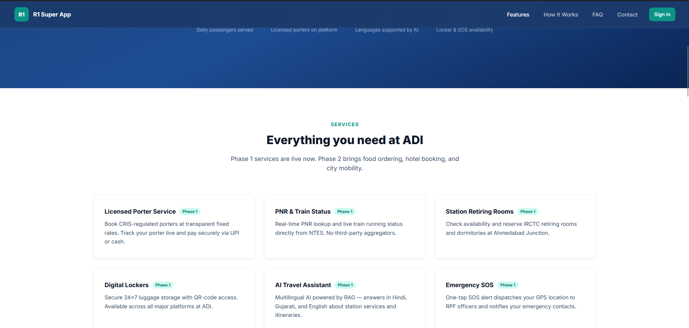

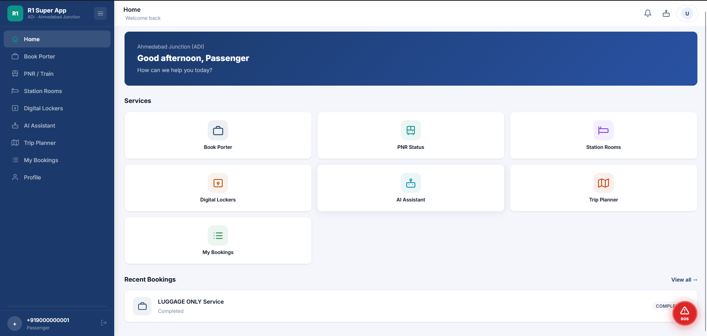

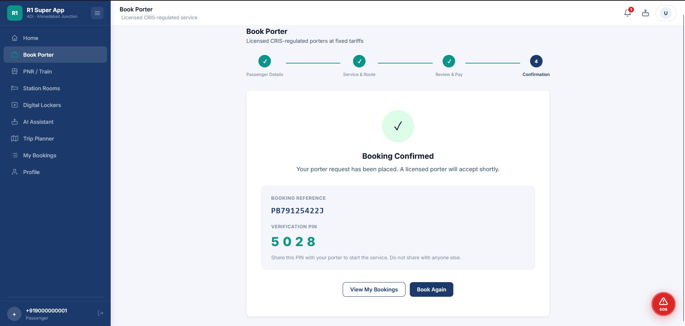

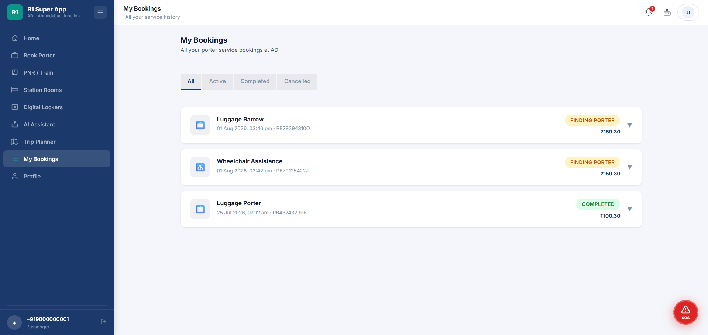

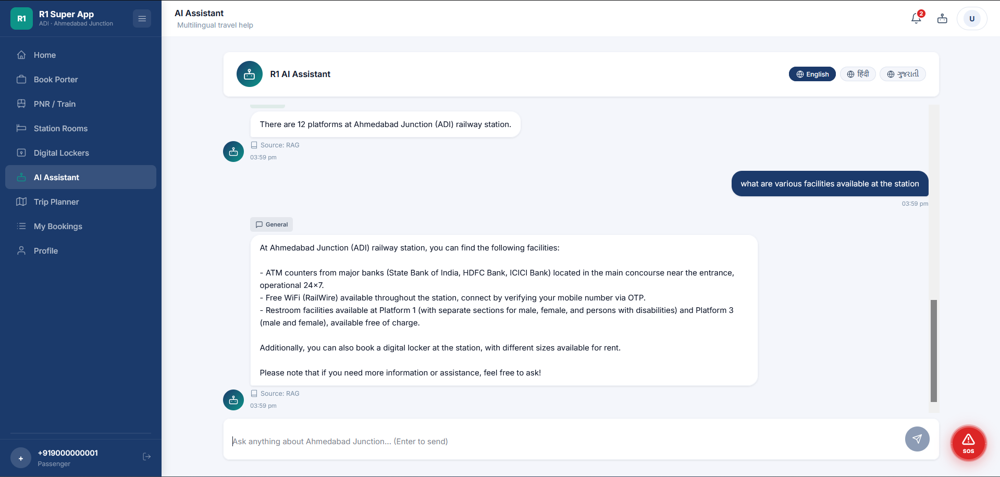

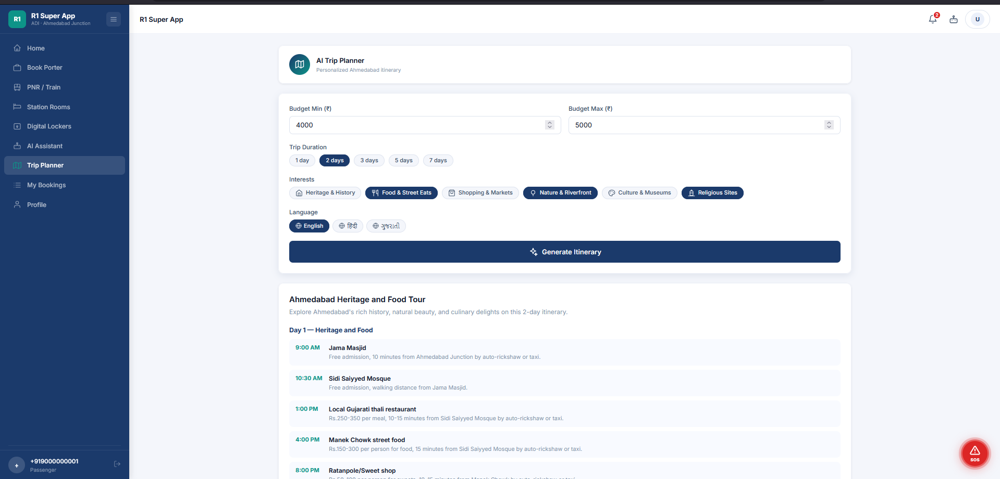

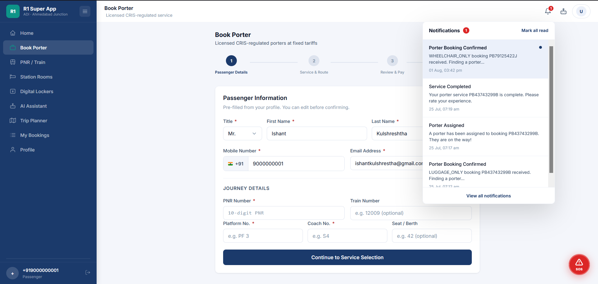

### Operations Module

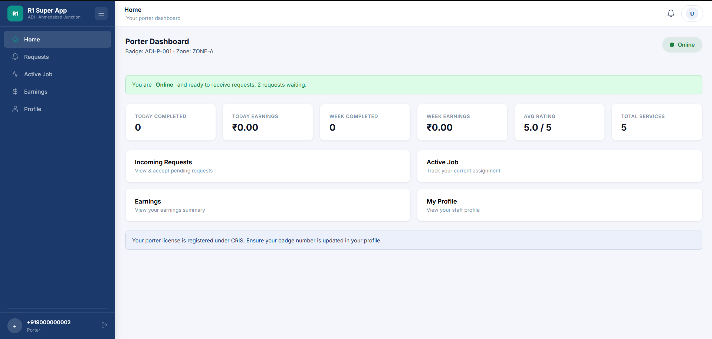

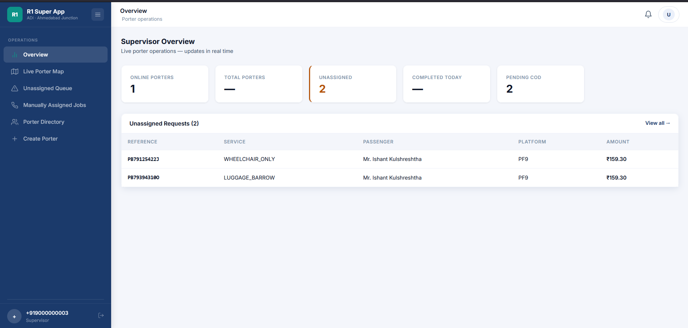

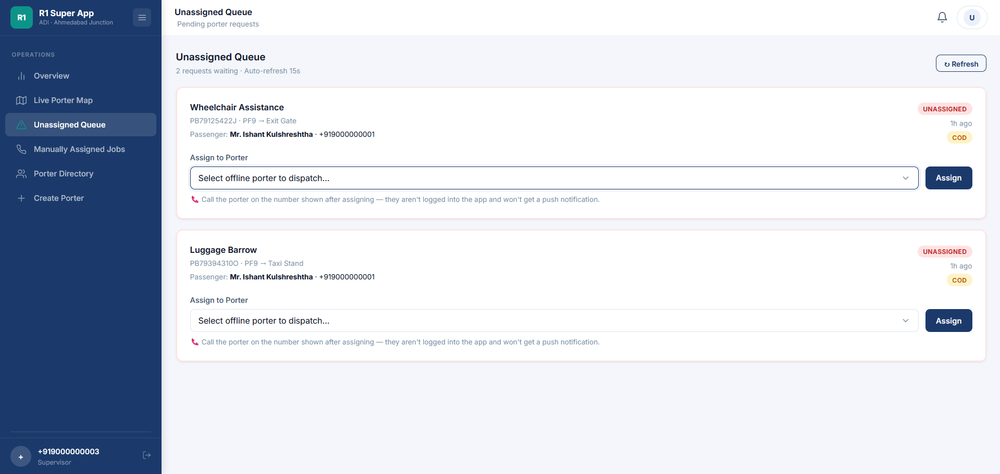

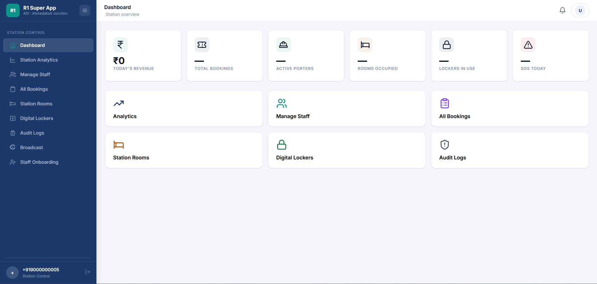

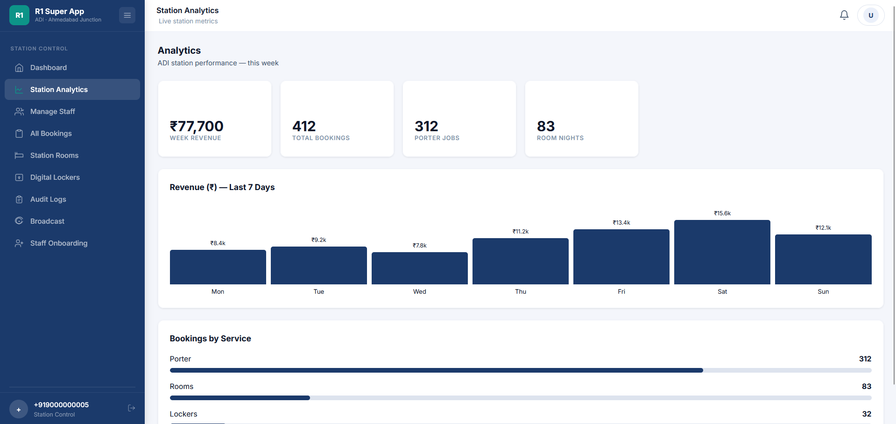

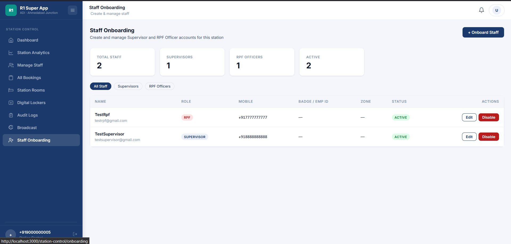

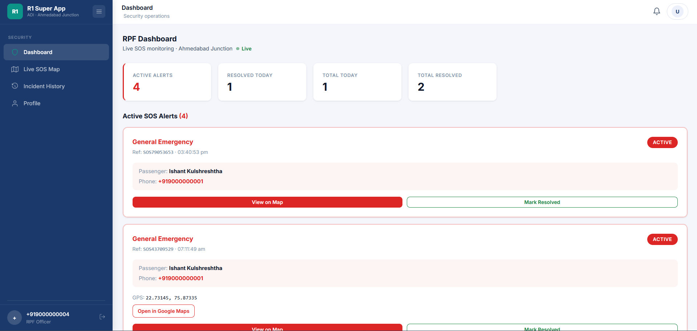

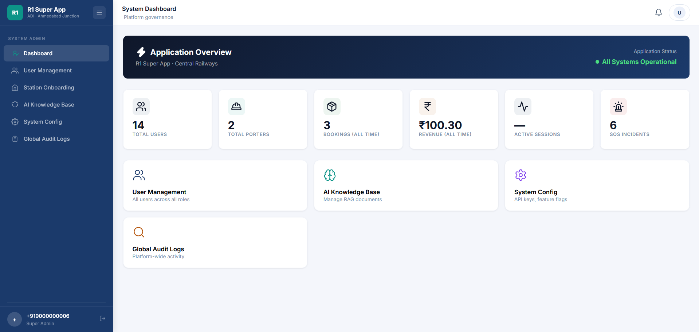
 
## Environment Variables
 
The following must be configured before running the platform:
 
- Database credentials (PostgreSQL)
- Redis connection details
- JWT signing secret
- Groq API key
- Google OAuth client credentials
- Kafka broker configuration
- Ollama base URL and embedding model name
 
## Running the Project
 
See **HOW_TO_RUN.md** for full local setup instructions.
 
## License
 
This project is intended for educational, research, and demonstration purposes.